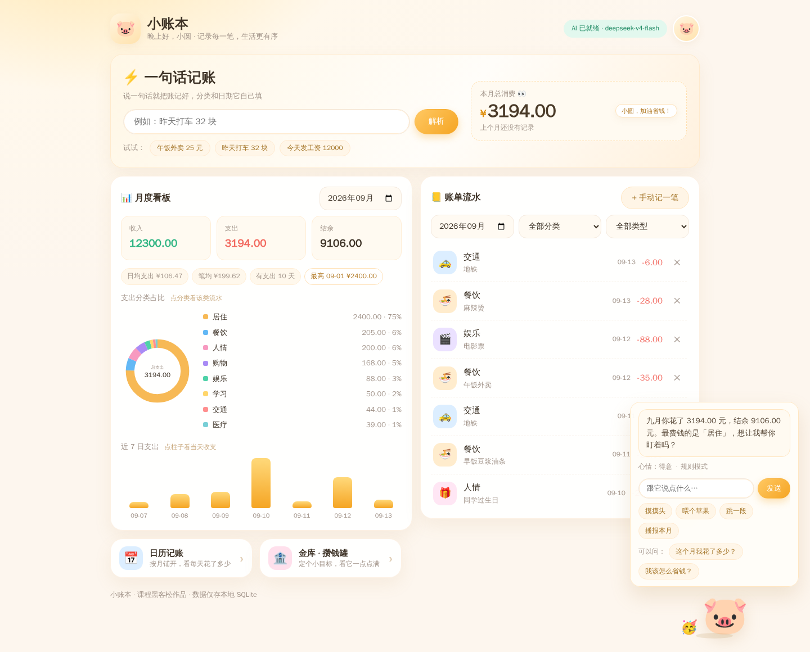

# 🐷 小账本 · 一句话记账

> 基于 [CNB](https://cnb.cool) 云原生平台打造的 AI 一句话记账助手

<p align="left">
  
</p>

说一句话就能记账，AI 帮你看懂钱包——记账、看板、日历、攒钱罐，还有一只会看账本的桌宠，全在一页里。

第 5 章迷你黑客松作品（方向 ③：解决生活痛点）。

## 如何开始

1. **Fork** 本仓库到你自己的账号下
2. 点击仓库页面右上角的 **「🐷 开始记账」** 按钮
3. 等待环境启动后，即可直接开始记账，**无需任何配置**

> 不用配密钥、不用装环境：预览页跑在 CNB 云原生环境里，大模型凭证由平台自动注入；注入失败也会自动退回规则引擎，功能一个不少。

## 作品简介

记账 App 的留存杀手不是功能少，而是**录入门槛高**——打开 App、选分类、输金额、选日期、保存，五六个动作才记一笔，坚持不过一周。

小账本只做一件事：**把记账从"填表单"降维成"说一句话"。**

```
午饭外卖 25 元      →  支出 · 餐饮 · 25.00 · 今天
昨天打车 32 块       →  支出 · 交通 · 32.00 · 昨天
今天发工资 12000     →  收入 · 工资 · 12000.00 · 今天
买了本理财书 50 元   →  支出 · 学习 · 50.00 · 今天   ← 不会被"理财"带偏成收入
```

AI 解析出来的只是**预览**：结果先渲染成可编辑的确认卡片，点「确认入账」才真正写进账本——**模型可以出错，账本不会脏**。

它也不只是记账：右下角常驻一只 AI 桌宠「账小猪」，心情跟着账本走；月度看板、日历回看、攒钱金库、换皮肤都在同一页里。

## 怎么记账

- **一句话记账**：说一句话 → AI 识别金额 / 分类 / 日期 → 可编辑的确认卡片 → 你点头才入账
- **手动补记**：识别不出来就手填，字段和确认卡片一致
- **回看**：月度看板（收支结余 + 分类环形图 + 近 7 日趋势）、日历（按天看花销，颜色越深花得越多）
- **攒钱**：按需新建金库，存钱时金币旋转坠落入罐，音效用 Web Audio 实时合成
- **打扮**：昵称、头像、背景都能换，偏好存在数据库里，换设备也在
- **没 AI 也能用**：顶栏显示「规则模式」时走的是关键词 + 正则兜底，功能一个不少

## 记账分类

| 类型 | 可选分类 |
|---|---|
| 支出 | 餐饮 · 交通 · 购物 · 娱乐 · 居住 · 医疗 · 学习 · 人情 · 其他 |
| 收入 | 工资 · 奖金 · 兼职 · 红包 · 理财 · 报销 · 其他 |

## 桌宠「账小猪」

| 心情 | 触发条件 |
|---|---|
| 👀 好奇 | 本月还没有任何记录 |
| 😊 开心 | 正常记账中 |
| 🥳 得意 | 结余 ≥ 收入的 30% |
| 😰 担心 | 支出超过了收入 |

- **摸得到的互动**：摸摸头 / 喂个苹果 / 跳一段，台词轮着不重复，纯本地响应，点了立刻有反馈；
- **说得出的账本**：问它「这个月我花了多少」「我该怎么省钱」「哪类花最多」，回答一定带真实数字；
- 账本一有变动，它会自己重新报一次数。

---

## 亮点

| 亮点 | 说明 |
|---|---|
| 🗣️ **一句话记账** | 口语直接变成结构化账单，自动识别金额、分类、日期 |
| 🤖 **AI 是增强项，不是必需项** | 未配置大模型时自动降级为规则引擎，**零配置也能完整使用** |
| ☁️ **云端零密钥** | 在 CNB 云原生环境里直接调用内置大模型，无需任何 Key |
| 🛡️ **AI 不直接写库** | 解析结果先渲染成可编辑确认卡片，用户点头才入账，杜绝幻觉污染账本 |
| 📊 **看板开箱即用** | 收支结余 + 分类占比环形图 + 近 7 日趋势，图表手写 SVG/CSS，**零第三方依赖** |
| 📅 **日历视图** | 按月看每天花了多少，金额越大格子颜色越深；支出/收入/收支/结余四种口径一键切换，点某天直接展开当天流水 |
| 🐷 **AI 桌宠「账小猪」** | 常驻右下角的浮层，心情由账本决定（好奇/开心/得意/担心）；能摸能喂能跳舞，也能回答「哪类最费钱」，没配大模型时走关键词规则兜底 |
| 🏦 **金库 · 攒钱罐** | 按需新建多个攒钱目标；存钱时金币旋转坠落，并用 Web Audio **实时合成**硬币入罐声 |
| 🎨 **可以换皮肤** | 昵称、头像（emoji 或上传照片）、背景（6 套主题或自定义图片），偏好跟着数据库走，换设备也在 |
| 📦 **一条命令运行** | Docker 打包，挂个 volume 就能持久化账本 |
| 🪶 **源码极简** | 后端 7 个模块、前端 7 个文件，没有构建步骤、没有 `node_modules`、没有音频/图片素材 |

---

## 快速开始

### 方式一：Docker（推荐）

```bash
# 构建
docker build -t money:local .

# 运行（-v 挂 volume，账本重启不丢）
docker run -d --name money -p 8686:8686 -v money-data:/app/data money:local

# 打开 http://localhost:8686
```

### 方式二：本地运行

```bash
pip install -r requirements.txt
python run.py
# 打开 http://localhost:8686
```

> 本地调试可换端口：`PORT=8080 python run.py`

### 方式三：CNB 一键预览

Fork 本仓库后，右上角会出现 **「🐷 开始记账」** 按钮，点一下直接出预览页，不用进 IDE、不用配任何密钥。

配置说明见下方 [部署到 CNB](#部署到-cnb)。

---

## 启用 AI 能力（可选）

**不配也能用**——此时会走规则引擎，顶栏角标显示「规则模式」。想让 AI 上场，二选一：

### 云端（推荐，零配置）

在 CNB 云原生环境 / 容器中，平台会**自动注入**：

```
CNB_API_ENDPOINT / CNB_REPO_SLUG / CNB_TOKEN
```

代码检测到这三个变量后自动启用 AI，顶栏显示「AI 已就绪」。**不需要写任何密钥。**

### 本地（需要令牌）

```bash
cp .env.example .env
```

编辑 `.env` 填入：

```bash
BASE_URL=https://api.cnb.cool/<你的org>/<你的repo>/-/ai-ide/v2
API_KEY=<你的 CNB 访问令牌>      # https://cnb.cool/profile/token/create
MODEL_ID=deepseek-v4-flash
```

> 🔐 `.env` 已在 `.gitignore` 中，**绝不会被提交**。仓库里只有 `.env.example` 模板。

---

## API 文档

| 方法 | 路径 | 说明 |
|---|---|---|
| GET | `/api/health` | 健康检查 + AI 可用性 |
| POST | `/api/parse` | 一句话 → 结构化账单（**只预览，不落库**） |
| POST | `/api/records` | 新增账单 |
| GET | `/api/records` | 流水查询（支持 `month` / `date` / `category` / `type` 过滤） |
| DELETE | `/api/records/<id>` | 删除账单 |
| GET | `/api/summary` | 月度统计 |
| GET | `/api/calendar` | 按月返回逐日收支（日历数据源） |
| GET | `/api/settings` | 读取个性化偏好 |
| PUT | `/api/settings` | 更新昵称 / 头像 / 背景 |
| POST | `/api/insight` | 生成 AI 消费洞察 |
| GET | `/api/pet/greeting` | 桌宠开场白（跟着账本走，附心情） |
| POST | `/api/pet/chat` | 和桌宠说一句话，回一句话 + 一个心情 |
| GET | `/api/vaults` | 金库列表（含已存金额 / 存钱次数 / 攒钱进度） |
| POST | `/api/vaults` | 新建金库 |
| DELETE | `/api/vaults/<id>` | 删除金库及其存钱记录 |
| POST | `/api/vaults/<id>/deposit` | 存钱入库 |
| GET | `/api/vaults/<id>/deposits` | 某个金库的存钱流水 |

<details>
<summary><b>展开查看请求/响应示例</b></summary>

**健康检查**

```bash
curl http://localhost:8686/api/health
# {"status":"ok","llm":false,"model":"deepseek-v4-flash","today":"2026-09-13"}
```

**一句话解析（不落库）**

```bash
curl -X POST http://localhost:8686/api/parse \
  -H 'Content-Type: application/json' \
  -d '{"text":"昨天打车 32 块"}'
```

```json
{
  "parsed": {
    "type": "expense",
    "amount": 32.0,
    "category": "交通",
    "note": "打车",
    "happened_on": "2026-09-12",
    "source": "rule",
    "raw_text": "昨天打车 32 块"
  }
}
```

**新增账单**

```bash
curl -X POST http://localhost:8686/api/records \
  -H 'Content-Type: application/json' \
  -d '{"type":"expense","amount":32,"category":"交通","note":"打车","happened_on":"2026-09-12"}'
# 201 {"record":{"id":1,...}}
```

**流水查询**

```bash
curl 'http://localhost:8686/api/records?month=2026-09&category=餐饮&type=expense'
# {"records":[...],"count":3}
```

**月度统计**

```bash
curl 'http://localhost:8686/api/summary?month=2026-09'
```

```json
{
  "month": "2026-09",
  "income": 12000.0,
  "expense": 3250.5,
  "balance": 8749.5,
  "record_count": 28,
  "categories": [
    { "category": "餐饮", "amount": 1200.0, "ratio": 0.369 }
  ],
  "recent_days": [
    { "date": "2026-09-07", "amount": 45.0, "expense": 45.0, "income": 0.0, "balance": -45.0, "count": 2 }
  ],
  "daily_avg": 108.35,
  "per_record_avg": 116.09,
  "expense_count": 28,
  "active_days": 19,
  "top_day": { "date": "2026-09-01", "amount": 2400.0 }
}
```

**AI 消费洞察**

```bash
curl -X POST http://localhost:8686/api/insight \
  -H 'Content-Type: application/json' \
  -d '{"month":"2026-09"}'
# {"month":"2026-09","source":"rule","text":"..."}
```

**桌宠聊天**

```bash
curl -X POST http://localhost:8686/api/pet/chat \
  -H 'Content-Type: application/json' \
  -d '{"message":"我该怎么省钱？","month":"2026-09"}'
# {"source":"rule","mood":"worry","text":"先把最大的一头「居住」管住：它花了 2400.00 元，占 75%。下个月给它定 1920 元上限，我帮你盯着。"}
```

**新建金库**

```bash
curl -X POST http://localhost:8686/api/vaults \
  -H 'Content-Type: application/json' \
  -d '{"name":"旅行基金","goal":3000,"icon":"✈️"}'
# 201 {"vault":{"id":1,"name":"旅行基金","saved":0.0,"goal":3000.0,"progress":0.0,"achieved":false,...}}
```

**存钱入库**

```bash
curl -X POST http://localhost:8686/api/vaults/1/deposit \
  -H 'Content-Type: application/json' \
  -d '{"amount":500,"note":"这个月省下的外卖钱"}'
# 201 {"deposited":500.0,"vault":{"saved":500.0,"progress":0.1667,"deposit_count":1,...}}
```

> 前端拿到响应后才会播放金币动画与音效 —— 动画不是装饰，它是"这笔钱真的存进去了"的反馈。

**日历数据**

```bash
curl 'http://localhost:8686/api/calendar?month=2026-09'
```

```json
{
  "month": "2026-09",
  "leading": 1,
  "days": [
    { "date": "2026-09-01", "day": 1, "is_today": false, "income": 0.0, "expense": 12.0, "balance": -12.0, "count": 1 }
  ],
  "income": 12000.0,
  "expense": 3250.5,
  "balance": 8749.5,
  "max_expense": 320.0,
  "max_income": 12000.0
}
```

> `leading` 是月首之前要留白的格子数（周一开头对齐）；`max_*` 是单日峰值，前端拿它算格子颜色深浅。

**读取 / 更新个性化设置**

```bash
curl http://localhost:8686/api/settings
# {"settings":{"nickname":"","avatar":"🐷","bg_preset":"cream","bg_image":""}}

curl -X PUT http://localhost:8686/api/settings \
  -H 'Content-Type: application/json' \
  -d '{"nickname":"小明","avatar":"🦊","bg_preset":"mint"}'
# {"settings":{"nickname":"小明","avatar":"🦊","bg_preset":"mint","bg_image":""}}
```

> 部分更新：只传的字段才改动。`avatar` 收 emoji（≤4 字符）或图片 data URL；`bg_image` 传空字符串即回到预设主题。

**错误响应**：统一为 `{"error": "<中文提示>"}`，`400` 参数错误 / `404` 资源不存在。

</details>

---

## 项目结构

```
keep-track-of-expenses/
├── app/                        # 后端
│   ├── __init__.py             # 应用工厂：装配静态目录 + 蓝图 + 首页
│   ├── db.py                   # 数据层：建表 / CRUD / 聚合统计（账单 + 金库 + 界面偏好）
│   ├── llm.py                  # LLM 能力层：凭证探测 + 流式调用封装
│   ├── parser.py               # 一句话解析（AI 通道 + 规则通道）
│   ├── insights.py             # 消费洞察（AI 版 + 模板版）
│   ├── pet.py                  # 桌宠「账小猪」：模型对话 + 关键词兜底 + 心情判定
│   └── routes.py               # API 蓝图：17 个 REST 接口
├── static/                     # 前端单页（零依赖、零 CDN、零素材文件）
│   ├── index.html              # 页面骨架
│   ├── style.css               # 样式（CSS 变量 + 响应式栅格 + 日历 + 金币动画 + 桌宠）
│   ├── app.js                  # 交互逻辑 + SVG 图表绘制 + 概览横幅 + 金库
│   ├── calendar.js             # 日历视图：月份切换 / 四种口径 / 点选当天流水
│   ├── profile.js              # 个性化：头像 / 昵称 / 背景 + 图片压缩
│   ├── pet.js                  # 桌宠浮层：心情表情 / 本地互动 / 聊天
│   └── coin.js                 # 金币坠落动效 + Web Audio 合成硬币入罐声
├── assets/
│   └── screenshot.png          # README 顶部的界面截图
├── tests/                      # pytest（不依赖网络与凭证）
│   ├── conftest.py             # 临时数据库夹具
│   ├── test_db.py              # 数据层：CRUD / 聚合 / 月份边界
│   ├── test_parser.py          # 解析器：规则通道 + AI 降级
│   ├── test_api.py             # 接口：主流程 + 参数校验
│   ├── test_vaults.py          # 金库：聚合不变量 / 攒满判定 / 不污染账本
│   ├── test_calendar.py        # 日历：整月补全 / 峰值 / 个性化设置校验
│   └── test_pet.py             # 桌宠：规则话术 / 心情判定 / 接口校验 / 模型降级
├── docs/
│   ├── spec.md                 # Spec 规格文档（Spec 先行）
│   └── cnb-开发分支配置.yml     # dev 分支专用 CNB 配置
├── Dockerfile
├── .cnb.yml                    # 流水线构建镜像 + 仅预览模式
├── .cnb/settings.yml           # 仓库右上角一键启动按钮
├── requirements.txt            # 运行依赖
├── requirements-dev.txt        # 开发依赖（pytest）
├── run.py                      # 启动入口（0.0.0.0:8686）
└── .env.example                # 环境变量模板
```

---

## 架构与核心设计

```
浏览器（单页界面）
   │  REST /api/*
   ▼
routes.py ──┬─→ parser.py ──────→ llm.py ──→ CNB LLM
            ├─→ insights.py ─────┘              │
            ├─→ pet.py ──────────┘          未配置时
            └─→ db.py ──→ SQLite               ↓ 降级
                 │  records                规则引擎兜底
                 │  vaults / vault_deposits
                 │  settings
                 ▼
        static/calendar.js（日历）· profile.js（皮肤）· coin.js（金币音效）· pet.js（桌宠）
```

### 设计决策：AI 是可插拔的增强项

`llm.available()` 是唯一的降级开关。探测不到大模型时：

| 能力 | AI 通道 | 降级通道 |
|---|---|---|
| 一句话解析 | 模型输出严格 JSON + 代码侧校验纠偏 | 正则提金额 + 关键词表定分类 + 规则解析日期 |
| 消费洞察 | 统计结果投喂模型，生成自然语言 | 模板按占比/活跃度/结余分支拼装 |
| 桌宠对话 | 人设 + 账本摘要一起投喂，口语化回一句 | 关键词表选话题，话术模板带上真实数字 |

带来两个直接好处：

1. **评审老师 Fork 后点一下就能玩**，不用配密钥；
2. **云端自动注入变量后自动升级**为 AI 版，代码零改动。

### 设计决策：解析与入库分离

AI 理解有出错概率。所以 `/api/parse` **只返回预览**，前端渲染成可编辑的确认卡片，用户点「确认入账」才调 `/api/records` 写库。中间还有一道服务端二次校验。

**模型可以出错，但账本不会脏。**

### 设计决策：泛化动词不参与分类判定

`买` 是动词不是分类信号。"买了本理财书"若按关键词优先匹配，会先命中「理财」（收入类）而被判成收入。因此：

- `买 / 买了` 这类泛化词只放进 `EXPENSE_HINTS`（作为"这是支出"的线索），**绝不放进分类关键词表**；
- 分类由名词决定（`书` → 学习、`药` → 医疗、`衣服` → 购物）。

`tests/test_parser.py::test_expense_verb_overrides_income_keyword` 专门锁死这个行为。

### 设计决策：金库独立成账，不并入收支

"存钱进金库"如果混进 `records`，月度结余就会被重复计一次（记一笔支出 → 又存一笔 → 钱凭空少了两次）。所以金库是**独立的攒钱账本**：

| 表 | 用途 | 写入方式 |
|---|---|---|
| `records` | 日常收支流水 | 可增可删 |
| `vaults` | 攒钱目标（名称 / 图标 / 目标额 / 配色） | 可增可删 |
| `vault_deposits` | 每笔存钱记录 | **只增不改**，保证可追溯 |

不变量：`vault.saved = SUM(vault_deposits.amount)`，由一条 `LEFT JOIN + GROUP BY` 汇总得出，不存冗余字段，因此永远对得上。
`tests/test_vaults.py::test_vaults_do_not_pollute_ledger` 锁死"金库不影响月度收支"。

另外 `goal = 0` 表示不设目标，此时 `progress` 恒为 0 且**永不判定为"已攒满"**——否则前端进度条会满格误导。

### 设计决策：桌宠是"账本的嘴"，不是第二个入口

桌宠不做成独立页面，而是常驻右下角的浮层——记账时它就在旁边，不用来回切页面。三条约束：

1. **不许脱离账本**：无论走模型还是规则，回话都用 `db.summary()` 的真实数字。`pet.chat` 会先把账本压成一段中文简报当上下文，并明确要求模型"只依据这些数据回答，不要编造不存在的账单"；
2. **心情由数据决定，不由随机数决定**：`_mood()` 只看结余率——超支担心、攒下三成以上得意、没记账好奇、其余开心。所以表情是可解释的，不是装饰；
3. **能离线演示**：摸头 / 喂食 / 跳舞是纯前端本地反应，台词轮着不重复，断网也不会冷场。

关键词表刻意按"具体 → 笼统"排序：`分类 / 哪类 / 最多` 排在 `花 / 支出` 前面，否则「我最爱花在哪一类」会被"花"字抢答成"本月总共花了多少"。
`tests/test_pet.py::test_chat_prefers_category_intent_over_total` 锁死这个优先级。

### 设计决策：日历由后端算好，前端只负责画格子

日历最容易写错的是排版（月首空几格、闰年 2 月、月份边界）和配色基准，这些全部收在 `db.calendar()` 里：

- 返回**整月每一天**（含没有记录的空白天），前端不用自己补日期；
- 返回 `leading`（月首之前要留白的格数，周一开始），前端不用算星期；
- 返回 `max_expense` / `max_income`（单日峰值），前端按 `当天金额 / 峰值` 映射颜色深浅。

前端只剩两件事：把格子摆进 CSS Grid、点某天拉 `/api/records?date=` 展开明细。
`tests/test_calendar.py` 逐月核对天数（含闰年 2 月），确保跨月边界没有 off-by-one。

### 设计决策：图片先压缩再入库

头像和背景图存的是 data URL，原图直接落库很容易把 SQLite 撑大。两道闸：

1. **前端压**：`profile.js` 用 canvas 把图缩到指定长边（头像 256px、背景 1600px）后重新编码 —— 头像保留 PNG 透明通道，背景一律转 JPEG；
2. **后端拦**：`PUT /api/settings` 只收 `data:image/(png|jpeg|webp|gif|avif);base64,...`，且头像 ≤ 400KB、背景 ≤ 1.5MB base64，超限直接 400。

于是即使用户丢进一张 30MB 的原图，进库的也只有几百 KB。

### 设计决策：动效与音效都不引入素材文件

"金币转圈 + 硬币掉进存钱罐的声音"很容易变成往仓库里塞 `.png` 序列帧和 `.mp3`。这两样都被规避了：

**金币旋转坠落** —— `coin.js` 动态生成 `<span class="coin">`，靠 CSS `rotateY(0 → 1080deg)` 把圆形压成一片，正是硬币翻转的观感；配合 `translate` 抛物线与 `scale` 缩小淡出，读作"落进罐子里"。金币数量随金额增加（3~10 枚），存得多看得见。

**硬币入罐声** —— 用 Web Audio **实时合成**三段音：
1. 「叮」硬币空中旋转的金属共鸣 → 两个略微失谐的三角波 + 高频泛音，`exponentialRampToValueAtTime` 做 6ms 极快起音 + 平滑收干；
2. 「当」撞到罐壁的脆响 → 白噪声过带通滤波器；
3. 「咚」落底的闷响 → 低频正弦。

每枚硬币的音高带 ±15% 随机抖动，多枚连发才像"哗啦"一片硬币而不是电子提示音。攒满目标时额外补一段 C-E-G-C 上行琶音。

顺带守住的细节：
- **音效开关**在右侧顶栏，状态存 `localStorage`，打开时试听一声；
- 系统开启「减弱动态效果」（`prefers-reduced-motion`）时不做位移动画，只保留进度条联动；
- `AudioContext` 在首次点击时预热，避开浏览器自动播放策略；
- `coin.js` 加载失败时 `app.js` 降级为空函数 —— **动画坏了也不影响存钱**。

---

## 开发

```bash
# 安装开发依赖
pip install -r requirements-dev.txt

# 跑测试（离线可跑，不需要任何密钥）
pytest -v

# 启动开发服务器
python run.py
```

测试原则：**不依赖网络、不依赖大模型凭证**。AI 通道通过 `monkeypatch` 打桩单独验证降级与纠偏行为，因此在 CI 里也能全绿。

---

## 部署到 CNB

本项目在 CNB 上要三份配置，都已经写好：

| 文件 | 作用 |
|---|---|
| `Dockerfile` | 定义镜像怎么构建、怎么跑 |
| `.cnb/settings.yml` | 在仓库右上角生成「🐷 开始记账」按钮 |
| `.cnb.yml` | ① 从中心仓库 include 作品自动化检查流水线；② push 到 main 自动构建推送镜像；③ 仅预览模式一键启动 |

### 步骤

1. **换镜像地址（重要）**
   编辑 `.cnb.yml`，把 `launch` 里的常量地址换成你自己的仓库：

   ```yaml
   docker.cnb.cool/<你的org>/<你的repo>:latest
   ```

   > ⚠️ 必须是**常量**，不能用 `${CNB_DOCKER_REGISTRY}` 之类的变量——否则别人 Fork 后会解析到自己仓库的路径，而对方仓库没构建过镜像，启动必定失败。

2. **把制品库设为公有**，否则访客拉不到镜像。

3. **推到 main 分支**，等 push 流水线跑绿（镜像就绪）。

4. 回到仓库首页，右上角出现「🐷 开始记账」——点一下就是预览页。

### 继续开发怎么办？

`onlyPreview: true` 会让主分支**再也点不进 IDE**。解决办法：

1. 新建 `dev` 分支并切换过去；
2. 用 `docs/cnb-开发分支配置.yml` 的内容覆盖 dev 分支的 `.cnb.yml`；
3. 在 dev 分支页面点「云原生开发」即可进 IDE；
4. 主分支保留仅预览配置对外展示，两者互不影响。

### 在本课程仓库内使用

本目录是一个**自包含项目**，可以整体拆成一个独立仓库：把上面的配置放在仓库根目录即可直接生效。

若要在课程仓库内预览，需要把 `.cnb.yml` 的 `main.push` 与 `$` 段合并到仓库根 `.cnb.yml`，并把构建命令改为：

```bash
docker build -t "${IMAGE}" -f bookkeeping-assistant/Dockerfile bookkeeping-assistant
```

---

## 常见问题

<details>
<summary><b>为什么打开是空白 / 连接被拒绝？</b></summary>

检查服务是否监听 `0.0.0.0` 而不是 `127.0.0.1`。本项目已在 `run.py` 固定为 `0.0.0.0`，若你改过请改回来。

</details>

<details>
<summary><b>顶栏显示"规则模式"是不是坏了？</b></summary>

不是。说明当前环境没有大模型凭证，系统正在用规则引擎工作，**所有功能都正常**。想启用 AI 见 [启用 AI 能力](#启用-ai-能力可选)。

</details>

<details>
<summary><b>数据存在哪？重启会丢吗？</b></summary>

默认存在 `data/money.db`（SQLite 单文件）。容器里挂载 volume 即可持久化：

```bash
docker run -d -p 8686:8686 -v money-data:/app/data money:local
```

</details>

<details>
<summary><b>为什么金额解析出错了？</b></summary>

规则通道要求句子里有数字。若有数字却识别不对，请提 Issue 附上原句。规则识别不了时，AI 通道会兜住（如果已启用 AI）。

</details>

<details>
<summary><b>为什么本地用 8080 端口？</b></summary>

`8686` 是 CNB 预览专用端口，在 CNB 开发模式下可能被 WebIDE 占用。本地调试建议 `PORT=8080 python run.py`。

</details>

<details>
<summary><b>存钱时金币动了但没声音？</b></summary>

按顺序排查：

1. 点一下金库板块右上角的 **🔊** 按钮，如果图标是 🔇 说明被静音了；
2. 系统/浏览器标签页是否静音，或音量是否为 0；
3. 浏览器是否支持 Web Audio（现代浏览器都支持）。不支持时 `coin.js` 会**静默降级为只有动画**，存钱功能不受影响；
4. 若声音被系统「减弱动态效果」之类设置拦住，打开音效开关时会试听一声，据此判断。

</details>

<details>
<summary><b>金库里的钱算进月度收支吗？</b></summary>

**不算**，这是有意为之。金库是独立的攒钱账本，存钱不会改变月度收入/支出/结余，否则同一笔钱会被重复计一次。
"金库与收支打通（存钱自动记一笔转出）"在「后续可做」里。

</details>

<details>
<summary><b>桌宠回答得像机器人 / 一直不吭声？</b></summary>

桌宠面板右下角会显示当前模式：

- **规则模式**：没探测到大模型，走关键词兜底，只能回答「花了多少 / 哪类最多 / 怎么省钱」这类固定话题，聊天会兜底成"本月花了多少"的播报；
- **AI 模式**：才有自由对话。

一直不吭声的话，检查 `pet.js` 是否加载成功——桌宠和金币动画一样属于**增强项，坏了不影响记账**。

</details>

<details>
<summary><b>和桌宠说话会记账吗？</b></summary>

不会，它只负责回话，不写库。要记账请用页面顶部的「⚡ 一句话记账」输入框（或手动记一笔），免得聊天内容被误判成账单。

</details>

---

## 开发历程（Git）

本仓库的提交历史（`git log --oneline`，由新到旧）：

| # | 提交 | 内容 |
|---|---|---|
| 1 | `chore: trigger pr recalculate` | 触发作品自动化检查重算 |
| 2 | `feat: 补回中心 CI 检查流水线的 include 配置` | 接入作品检查流水线 |
| 3 | `feat: 修复仅预览模式配置` | `launch` 收进 `options`、镜像地址写常量、补 `stages` |
| 4 | `feat: 增加仅预览` | 仓库右上角「🐷 开始记账」按钮 + 仅预览模式 |
| 5 | `ci: 注释掉 vscode 服务配置以关闭 IDE 预览` | 暂时关掉 IDE 预览，专注端口预览 |
| 6 | `feat: 小账本记账助手（一句话记账 + 月度看板 + AI 桌宠）` | 项目主体：数据层、解析器、看板、日历、金库、皮肤、桌宠与全套测试 |
| 7 | `feat: delete some unuseful file` | 清理模板残留 |
| 8–10 | `docs:` 系列三条 | 端口 8080 约定、必须监听 0.0.0.0:8686、阶段检查内容改为提交规范 |
| 11 | `feat: 初始化小游戏合集Hackathon模板` | CNB 模板仓库起点 |

**分支现状**：`main`（默认分支，对外展示）与 `feat` 的文件内容完全一致，同一份改动各推了一次。要继续开发请按 [继续开发怎么办](#继续开发怎么办) 建 `dev` 分支，别在 `main` 上开 IDE。

查看历史：

```bash
git log --oneline --graph
```

---

## 后续可做

- [ ] 账单编辑（当前只支持删除后重记）
- [ ] CSV 导出，方便丢进 Excel 做进一步分析
- [ ] 预算上限与超支提醒
- [ ] 语音输入记账（配合浏览器 Web Speech API）
- [ ] 按周/按年维度的趋势对比
- [ ] 金库与收支打通：存钱时同步记一笔"转出"，月度结余可直接扣减金库存款
- [ ] 金库里程碑提醒：攒到 25% / 50% / 75% / 100% 时给一句鼓励
- [ ] 存钱流水可视化（当前接口 `/api/vaults/<id>/deposits` 已就绪，缺前端面板）
- [ ] 点日历某天直接补记一笔（当前只支持查看当天流水）
- [ ] 桌宠记性：记住你立过的攒钱目标，下次主动追问进度
- [ ] 桌宠语音：让「账小猪」把月度播报念出来（Web Speech API，零音频文件）
- [ ] 周期性账单（房租、订阅自动生成）

---

## 开始记账

Fork 本仓库后，点击页面右上角 **「🐷 开始记账」** 按钮即可开始。

祝你每一笔都记得清楚，钱越攒越多。

---

## 许可

MIT License —— 随便用、随便改，记得请自己吃顿好的。
